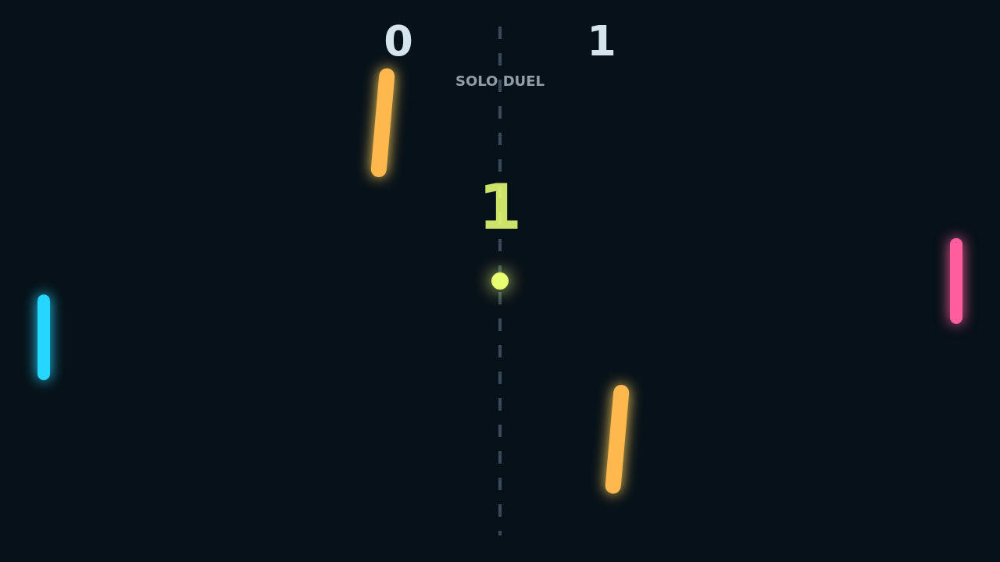

# Carom

Carom is a quick top-down paddle duel about turning a clean return into a
curving problem. The ball starts at center, snaps into play, and quickly becomes
less predictable as each paddle strike adds spin from the paddle's motion.

The middle of the field is never empty. Two bright bars sway and rotate through
the lane, so a safe shot can bank into a sharper angle and a desperate block can
become a winner. Good rallies feel like steering a ricochet through traffic.

Solo mode lets one player fight the AI with either key pair, while Versus puts
both paddles on the keyboard for local play. First to eleven, win by two, makes
every late point a small geometry argument.
